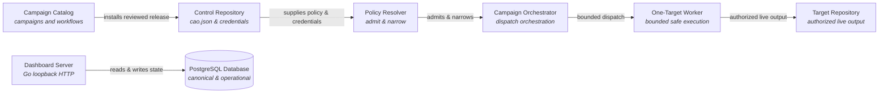

# Central Agentic Ops — System Architecture Diagram
*Generated from Top-Level Design (`tld`)*



---

### Command to Re-render

To export the raw Mermaid diagram at any time:

```sh
tld render root -o .tld/architecture.mmd
```
