CAO separates evidence collection from execution authority. Observing a workflow
does not change where it runs or who owns it. Explicitly integrated workflows
use the control plane for policy-governed execution. For the operating flow,
start with [What is CAO?](architecture-at-a-glance.md#how-it-works); this page
explains the components and trust boundaries.

## Control plane and dashboard

The **control plane** runs participating workflows in GitHub Actions from a
control repository. It owns admission, bounded execution, rollout, and output
routing. CAO Activity is a separate collection pipeline: it supplies evidence
without granting execution authority.

The **dashboard** presents that evidence. Where it is hosted does not change
workflow policy or target authority. The published dashboard is not the
control plane: viewing a result does not start work, approve an output, or
promote a workflow.

See [dashboard hosting](#evidence-and-dashboard-hosting) below and
[Deployment options](deployment.md) for infrastructure choices.

## Mental Model

  
  

The diagram shows the campaign pattern. A governed standalone workflow instead
performs its mission directly against a bounded admitted set, without an
orchestrator or downstream workers. Campaigns are a packaging and rollout
pattern, not a requirement for monitoring or governed execution. Direct
operations instead request explicit targets without inventory selection.
[From Outcome to Execution](operation-patterns.md) derives the structure from
the desired outcome, target scope, and execution requirements.

## System Architecture Topology

The end-to-end component topology and execution data flow across Central Agentic Ops:

```mermaid
flowchart LR
  accTitle: Central Agentic Ops System Architecture
  accDescr: End-to-end component topology showing Campaign Catalog, Control Repository, Policy Resolver, Campaign Orchestrator, One-Target Worker, Target Repository, Dashboard Server, and PostgreSQL Database.
  catalog["Campaign Catalog<br/><i>campaigns and workflows</i>"]
  control_repo["Control Repository<br/><i>cao.json & credentials</i>"]
  policy_resolver["Policy Resolver<br/><i>admit & narrow</i>"]
  orchestrator["Campaign Orchestrator<br/><i>dispatch orchestration</i>"]
  worker["One-Target Worker<br/><i>bounded safe execution</i>"]
  target_repo["Target Repository<br/><i>authorized live output</i>"]
  dashboard_server["Dashboard Server<br/><i>Go loopback HTTP</i>"]
  postgres_db[("PostgreSQL Database<br/><i>canonical & operational</i>")]

  catalog -->|installs reviewed release| control_repo
  control_repo -->|supplies policy & credentials| policy_resolver
  policy_resolver -->|admits & narrows| orchestrator
  orchestrator -->|bounded dispatch| worker
  worker -->|authorized live output| target_repo
  dashboard_server -->|reads & writes state| postgres_db
```

### Component Roles and Boundaries

| Component | Responsibility | Boundary & Authority |
| --- | --- | --- |
| **Campaign Catalog** | Versioned repository holding campaign sources, manifests (`aw.yml`), and releases. | Supplies packages to install; holds no execution credentials or target access. |
| **Control Repository** | Host repository managing `.github/workflows/cao.json` policy and Actions secrets. | Sole persistent rollout policy authority; dispatches orchestrators and workers. |
| **Policy Resolver** | Bounded policy evaluation kernel that admits targets and narrows permissions. | Resolves ceilings without discovering extra repositories or mutating policy. |
| **Campaign Orchestrator** | Dispatches work for admitted targets according to resolved policy and mode. | Bounded inventory selection; does not mutate targets directly. |
| **One-Target Worker** | Executes agentic tasks against exactly one assigned target repository. | Operates with declared safe outputs; cannot widen scope or dispatch work. |
| **Target Repository** | Repository receiving declared safe outputs (PRs, issues, or review artifacts). | Owns target code protections; its files cannot grant control-plane authority. |
| **Dashboard Server** | Go server hosting the web UI, OAuth authentication, and query API. | Bounded loopback or hosted service executing queries against PostgreSQL. |
| **PostgreSQL Database** | Persistent relational storage for canonical and operational state. | Rebuildable projection storing activity shards, run counts, and budgets. |

### Repository roles and records

| Role | Owns | Does not grant |
| --- | --- | --- |
| Catalog | Versioned campaign source, manifests, and releases | Installation credentials or runtime authority |
| Control repository | Reviewed policy, Actions secrets, installed or source-managed workflows, and runs | Ownership of target code or merge acceptance |
| Target repository | Source evidence, repository protections, local automation, and acceptance of changes | Control-plane authority through its own files |
| Review repository | Declared proposals and review artifacts | Permission to mutate the target |

:::note[Three records, three jobs]
Campaign manifests record what was published and installed. The control
repository owns operating policy and credential references. Target-owner
enrollment records document consent for live operation. These records do not
replace one another; target files do not grant, narrow, or veto control-plane
authority.
:::

Any repository can explicitly be a source-managed control plane for workflows
it maintains in-tree. A catalog can also use that topology for dogfooding, but
catalog files alone do not activate the control role. In either case, workflow
sources and generated locks are the runtime payload; policy remains a separate
reviewed record. See [Deployment and Governance](deployment-and-governance.md)
for runtime ownership, multi-organization topologies, and enrollment procedures.

## Authority and admission

The control repository's `.github/workflows/cao.json` is the sole persistent
non-secret rollout policy. Runs resolve it at the exact workflow revision, so
policy and workflow changes belong in one reviewed commit. Credentials stay
in Actions secrets; steering Markdown may refine the mission but cannot grant
scope or capabilities.

A run's effective authority is the intersection of reviewed policy, the
request, worker ceilings, credential reach, and gh-aw-compiled capabilities.
No input can widen another. Manual requests may narrow an authorized run,
not promote its mode or expand its limits.

Admission validates identity, policy, requested limits, and API capacity
before agent execution. Authorized-run precompute resolves repository
inventory or explicit targets, routing, access, and eligible workers where
applicable. The topology-independent authority kernel resolves ceilings without
performing discovery or dispatch. The agent receives a validated
non-secret control artifact, not the policy credentials used for precompute.
GitHub Agentic Workflows owns how the authorized workflow executes and which
tools, permissions, and safe outputs it can use.

See [Admission Gates](admission.md), [Configuration](configuration.md), and the
[control architecture specification](https://github.com/githubnext/gh-cao/blob/main/specs/control-architecture.md)
for the exact contracts.
The [authority envelope contract](authority-envelopes.md) describes direct
execution identity binding, scoped grants and unsupported capabilities.

## Execution boundaries

Campaign orchestrators and workers run from the control repository. The
orchestrator selects and dispatches within resolved policy; each worker checks
out and analyzes only its assigned target. Targets receive only declared safe
outputs, not control-plane workflow definitions. Standalone workflows execute
directly against their admitted set and cannot discover extra targets or
dispatch more work.

Dispatch carries target, mode, output destination, and correlation metadata,
never credentials. Workers revalidate their authority and may only narrow it.
Run URLs and correlation IDs support investigation; they are not independent
proof that a particular orchestrator issued a request. See
[Execution and Safety](execution-and-safety.md) for the handoff, invariants,
and failure behavior, [Orchestrators and Workers](orchestrators-and-workers.md)
for campaign roles, and [Rollout and Routing](rollout-and-routing.md) for
review-to-live procedures.

## Evidence and dashboard hosting

Activity collects bounded workflow evidence once for reuse by dashboards,
reports, local tools, and agents. Published data and query stores are
rebuildable projections, not rollout authority or a substitute for current
GitHub state. Derived intelligence is advisory, not permission to execute.

| Dashboard deployment | Presentation and query boundary |
| --- | --- |
| Static GitHub Pages | The browser downloads the published snapshot; a data Web Worker prepares it and runs queries against browser-local storage. |
| Hosted Go server | The same Go handler serves the UI, assets, sign-in, query API, and revision events; dashboard queries run server-side over PostgreSQL. |

Hosted mode is not a Pages frontend with a separate API. It does not fall back
to browser storage or static shards when the hosted service fails.
[Deployment options](deployment.md) compares the profiles;
[CAO Activity](activity.md) describes collection and retention, and
[Data ingestion](dashboard-data-ingestion.md) follows the evidence into queries.

Repository visibility and dashboard visibility are separate decisions. Use a
public control repository only when policy, run metadata, evidence, dashboard
data, and review outputs can all be public. A private repository does not
guarantee private Pages; [setup](setup-quickstarts.md) checks publication
visibility.

## Core Safety Properties

- `review` is the default; live output requires explicit reviewed authorization.
- Target selection, execution, and dispatch are bounded.
- Each live target/campaign pair has one assigned control-repository mutation
  authority; target-owner consent is recorded separately.
- Orchestrators select work but do not mutate targets directly.
- Workers cannot discover extra targets, dispatch further work, or widen mode.
- GitHub tools are read-only; repository writes use declared safe outputs.
- Credentials are resolved inside runs, never carried in dispatch inputs.
- Missing authority, authentication, routing, eligibility, or required evidence
  fails closed.

:::caution[The control plane is not a universal policy boundary]
CAO governs explicitly integrated standalone workflows and campaigns, not
every observed workflow or every workflow hosted in a control repository.
GitHub rulesets, Actions policy, protected environments, CODEOWNERS, credential
scoping, and repository review requirements remain separate controls.
Independent control repositories do not share cancellation or execution locks.
See [Governance Boundary](deployment-and-governance.md#governance-boundary).
:::
